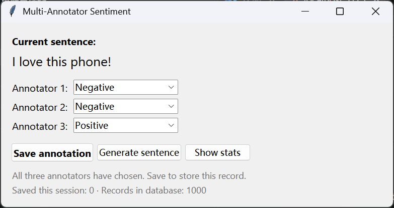
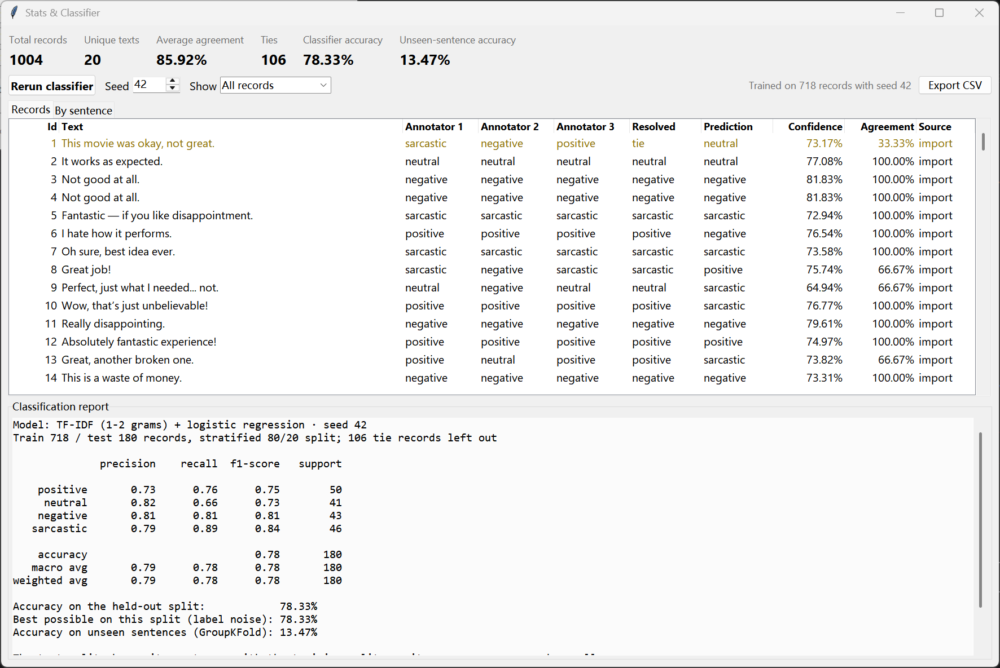

# Multi-Annotator Sentiment

A Tkinter desktop app for a three-annotator sentiment workflow. Each sentence gets a label from three annotators, the record is stored in SQLite and can never be changed, and a stats window shows agreement and a classifier trained on the saved records.

The product spec, with priorities and acceptance criteria, is in [PRD.md](PRD.md).





## Run

Requires Python 3.10 or newer with Tkinter, which the python.org installers include.

```bash
python -m venv .venv
.venv\Scripts\activate            # macOS/Linux: source .venv/bin/activate
pip install -r requirements.txt

python app.py
```

On first start the app creates `annotations.db` and imports `multi_annotator_dataset_list.csv` (1000 records). To import by hand:

```bash
python import_data.py            # --csv PATH --db PATH to override
```

Running the import again skips rows that are already there.

## Use

1. **Annotator window.** It shows a random sentence from the database. Choose a label for Annotator 1, 2 and 3. **Save annotation** is enabled only when all three have chosen. After saving, the record is locked and shows its record number. Press **Generate sentence** for the next sentence.
2. **Show stats** opens the Stats & Classifier window:
   - **Summary.** Total records, unique texts, average agreement, ties, classifier accuracy, and unseen-sentence accuracy.
   - **Records tab.** Every record with its three labels, resolved label, prediction, confidence, agreement and source. Records added in the app are highlighted. **Show** filters the table to imported or new records.
   - **By sentence tab.** The vote count for each label and the majority label, for each of the 20 sentences.
   - **Classification report**, from scikit-learn.
   - **Rerun classifier** reloads the database and retrains with the seed shown. The window also refreshes itself after each save.
   - **Export CSV** writes the table with its resolved labels and predictions.

## Rules

| | |
| --- | --- |
| Resolved label | The label at least two of the three annotators chose. When all three differ, the record is a **tie** |
| Agreement | Votes for the commonest label ÷ 3: 100%, 66.67% or 33.33% |
| Immutability | SQLite triggers reject every `UPDATE` and `DELETE`, and any insert that reuses an existing id, so `INSERT OR REPLACE` can't overwrite a record either |
| Classifier | TF-IDF (1–2 grams) and logistic regression. It trains on all non-tie records with a stratified 80/20 split and a fixed seed |

## Reading the classifier numbers

The dataset has 1000 records but only 20 distinct sentences, and a sentence often carries different labels in different records. For example, "I hate how it performs." is labelled positive by all three annotators in some records. The report therefore shows three accuracy figures:

- **Accuracy on the held-out split.** The test records reuse sentences the model was trained on, so this figure measures how well the model recalls each sentence's usual label.
- **Best possible on this split.** No model that only reads the text can beat this, because the same text has conflicting labels in the test split. The classifier usually lands on or near it.
- **Accuracy on unseen sentences.** GroupKFold keeps whole sentences out of training. With only 20 sentences to learn from, this figure is low. It shows how little the model generalises to new text.

## Test

```bash
pip install -r requirements-dev.txt
pytest
```

The 40 tests cover:
- Import and its validation.
- Idempotent re-import.
- Immutability against `UPDATE`, `DELETE` and `INSERT OR REPLACE`.
- Majority vote and ties.
- The classifier, including that its accuracy never exceeds the best possible.
- The annotator window's save-button rules.
- The stats window and CSV export.

## Layout

```
app.py          Tkinter: annotator window and Stats & Classifier window
analysis.py     majority vote, agreement, classifier, per-sentence summary (no UI code)
db.py           schema, immutability triggers, import, inserts, queries
import_data.py  command-line import
tests/          pytest
```
